   

  

## ✦ About me

I'm **Arjun Malik**, a student at **UpGrad School of Technology** and the founder of **[MolBhav](https://molbhav-gamma.vercel.app)**, a Pune startup that forecasts mandi prices of tomatoes, onions and potatoes so restaurants and cloud kitchens know what to buy and when.

I like taking an idea all the way to a live product: real data, a clean interface, and something people can use the same day.

- 🔭 **Building:** MolBhav — real AGMARKNET prices, live charts and 14-day estimates
- 🎙️ **Hacking on:** FRIDAY, a Python voice assistant built from scratch
- 🌱 **Learning:** backend systems, data pipelines and AI tools
- 🤝 **Open to:** pilots with Pune restaurants and cloud kitchens

## 🛠️ Tech stack

  

**Languages:** `JavaScript` · `Python` · `HTML` · `CSS`  
**Backend & data:** `Node.js` · `Express` · `libSQL / Turso` · `REST APIs`  
**Tools:** `Git` · `GitHub` · `Vercel` · `Linux / WSL` · `VS Code`

## 📂 Featured projects

<table>
<tr>
<td width="50%" valign="top" align="center"> <a href="https://github.com/Arj052/molbhav-mvp"><b>Repository ↗</b></a> · <a href="https://molbhav-gamma.vercel.app"><b>Live site ↗</b></a></td>
<td width="50%" valign="top" align="center"> <a href="https://github.com/Arj052/friday"><b>Repository ↗</b></a></td>
</tr>
<tr>
<td width="50%" valign="top" align="center"> <a href="https://github.com/Arj052/levity-energy-"><b>Repository ↗</b></a> · <a href="https://arj052.github.io/levity-energy-/"><b>Live site ↗</b></a></td>
<td width="50%" valign="top" align="center"> <a href="https://github.com/Arj052/Awasars"><b>Repository ↗</b></a> · <a href="https://arj052.github.io/Awasars/"><b>Live site ↗</b></a></td>
</tr>
</table>

<b>✦ MolBhav — features & highlights</b>

 

- Real wholesale prices for tomato, onion and potato from AGMARKNET (data.gov.in), across Pune mandis
- TradingView-style live chart, 3 months of history and a 14-day estimate with a buy / wait / steady signal
- Google sign-in, a business-details step and a personal dashboard
- Private admin panel with a live login counter, search and CSV export
- Express + libSQL on Vercel (Mumbai region) with a Turso database; Motion scroll story and per-vegetable colour themes

<b>✦ FRIDAY — features & highlights</b>

 

- Python AI voice assistant that runs in WSL
- Bridges to Windows for audio, opening the browser and speech output
- Documented as a public, day-by-day build log

<b>✦ Levity Energy — features & highlights</b>

 

- 3D, floating-style product showcase with interactive depth effects
- Spinnable, flavour-reactive can and scroll-driven transitions
- Working product showcase and purchase flow
- Hosted on GitHub Pages

<b>✦ Awasars — features & highlights</b>

 

- Bridges the gap between education and employment for young people
- Internships, mentorship and career opportunities in one place
- Hosted on GitHub Pages

## 🤝 Let's connect

  

MolBhav, Levity and Awasars are live. FRIDAY is a work in progress.

